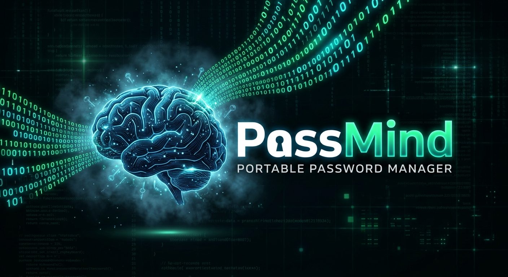

# PassMind



Portabler Passwort-Safe mit Weboberfläche. Eine einzige Programmdatei pro Plattform, keine Installation, keine Cloud. Läuft z. B. direkt vom USB-Stick unter Windows, macOS und Linux.

## So funktioniert es

- Beim Start öffnet PassMind einen kleinen Webserver **nur auf 127.0.0.1** und öffnet die Oberfläche im Standardbrowser.
- Der Tresor ist eine verschlüsselte Datei `passmind.vault` **direkt neben dem Programm**. Programm und Tresor zusammen auf den Stick kopieren, fertig.
- Beim Speichern wird die vorherige Fassung als `passmind.vault.bak` behalten.

## Funktionen

- Ordner (beliebig verschachtelt) in einer Baumansicht, Einträge per Drag & Drop verschieben
- Einträge mit Titel, Benutzername, Passwort, URL, Notizen und Tags
- Suche über alle Felder (`Strg+F`), neuer Eintrag mit `Strg+N`, Sperren mit `Strg+L`
- Integrierter **Passwortgenerator**: Zeichen (Länge, Gruppen, ähnliche Zeichen vermeiden) oder Passphrase aus Wörtern
- Stärkeanzeige für Passwörter
- Kopieren in die Zwischenablage mit automatischem Leeren (Standard 20 s)
- Passwort-Verlauf pro Eintrag (die letzten 20)
- Automatische Sperre bei Inaktivität (Standard 5 min)
- **MFA beim Start**: Master-Passwort plus 6-stelliger Code aus einer Authenticator-App (TOTP), dazu 8 Wiederherstellungscodes
- Optional eine **Schlüsseldatei** als zusätzlicher Schlüssel
- CSV-Import (Passwordstate, KeePass, Bitwarden, Excel mit Komma oder Semikolon) und CSV-Export

## Starten

1. Passende Datei aus den [Releases](../../releases) laden, z. B. `passmind-windows-amd64.exe`.
2. Auf den USB-Stick kopieren und starten.
3. Beim ersten Start führt ein Assistent durch Master-Passwort, Authenticator-App und Wiederherstellungscodes.

Hinweise zu den Betriebssystemen:

- **Windows:** SmartScreen warnt bei unbekannten Programmen. „Weitere Informationen“ → „Trotzdem ausführen“.
- **macOS:** Die Datei ist nicht signiert. Einmalig `xattr -d com.apple.quarantine passmind-darwin-arm64 && chmod +x passmind-darwin-arm64` im Terminal ausführen, danach per Doppelklick oder `./passmind-darwin-arm64` starten. Intel-Macs nehmen `darwin-amd64`.
- **Linux:** `chmod +x passmind-linux-amd64 && ./passmind-linux-amd64`

Die Windows-Version trägt das PassMind-Icon. Unter macOS und Linux haben einzelne Programmdateien kein eigenes Icon; für Verknüpfungen liegt [`assets/passmind.ico`](assets/passmind.ico) bzw. [`assets/icon.png`](assets/icon.png) bereit.

Das Konsolenfenster muss offen bleiben, solange PassMind läuft. Beenden über den ⏻-Knopf in der Oberfläche oder mit `Strg+C`.

Optionen:

```
-vault <pfad>   anderer Ort für die Tresordatei
-port <nummer>  fester Port statt automatisch
-no-browser     Browser nicht automatisch öffnen (Adresse steht in der Konsole)
-version        Version anzeigen
```

## Sicherheit

| Thema | Umsetzung |
| --- | --- |
| Schlüsselableitung | Argon2id (3 Durchläufe, 64 MiB, 4 Threads), 32 Byte Salt |
| Verschlüsselung | AES-256-GCM; der unverschlüsselte Dateikopf ist als AAD mit authentifiziert |
| Schlüsseldatei | SHA-256 der Datei, per HMAC mit dem Master-Passwort verknüpft, bevor Argon2id läuft |
| MFA | TOTP nach RFC 6238 (SHA-1, 6 Stellen, 30 s, ±1 Zeitfenster); Wiederherstellungscodes nur gehasht gespeichert, je einmal gültig |
| Netzwerk | Server lauscht nur auf 127.0.0.1; Host-Header-Prüfung gegen DNS-Rebinding |
| Sitzung | Zufälliger Startlink setzt ein HttpOnly/SameSite=Strict-Cookie; schreibende Anfragen brauchen einen eigenen Header (CSRF-Schutz); strikte Content-Security-Policy |
| Fehlversuche | Ansteigende Wartezeit nach falschen Anmeldungen, einheitliche Fehlermeldung |
| Export | Nur nach erneuter Eingabe des Master-Passworts |

**Wichtig zur MFA:** Bei einer lokalen Tresordatei schützt der TOTP-Code den Zugang über die Oberfläche. Wer die Tresordatei selbst kopiert, muss trotzdem „nur“ das Master-Passwort (und ggf. die Schlüsseldatei) knacken. Für echten zweiten Faktor bei der Verschlüsselung die **Schlüsseldatei** nutzen und getrennt vom Tresor aufbewahren.

Ohne Master-Passwort (bzw. Schlüsseldatei) gibt es **keine Möglichkeit**, den Tresor wiederherzustellen. Regelmäßig eine Kopie von `passmind.vault` sichern.

## Selbst bauen

Benötigt Go (Version siehe `go.mod`).

```
go test ./...
./build.sh          # alle Plattformen nach ./dist
go build .          # nur für das aktuelle System
```

Das Windows-Icon und die Versionsinfos stecken in `rsrc_windows_*.syso`. Nach Änderungen an `winres/` neu erzeugen mit:

```
go run github.com/tc-hib/go-winres@latest make --arch amd64,arm64
```

Ein Git-Tag `v*` baut über GitHub Actions automatisch ein Release mit allen Plattformen.

## Lizenzen

Die Wortliste für Passphrasen ist die [EFF Large Wordlist](https://www.eff.org/dice) (CC BY 3.0 US).
